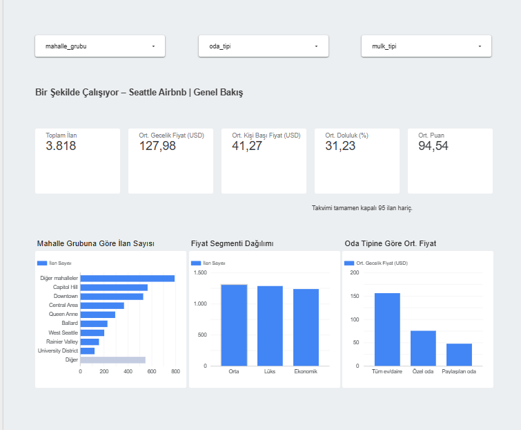

# Bir Şekilde Çalışıyor – Seattle Airbnb Fiyat ve Doluluk Analizi

YBS305 İş Zekâsı ve Veri Madenciliği dönem projesi: Seattle Airbnb verisiyle dbt ETL, etkileşimli dashboard ve fiyat tahmin modeli.

## Ekip ve Görev Dağılımı

| Üye | Veri ve dbt | Dashboard | Dokümantasyon | Bölüm 2 |
| --- | --- | --- | --- | --- |
| Eray Aysan (030424046) | Repo ve dbt altyapısı, Excel→CSV script'i, `stg_ilanlar` | Looker raporunun kurulumu, veri aktarım script'i, tema ve filtreler, Genel Bakış sayfası | README iskeleti, Nasıl Çalıştırılır | Streamlit uygulaması, deployment, entegrasyon |
| Rauf Hakan Gençeli (030424013) | `dim_ev_sahibi` | Ev Sahibi Analizi sayfası | Ev sahibi analizi bölümü | Özellik tablosu, keşifsel analiz |
| Suden Eraslan (030424026) | `fct_ilan_performans`, `relationships` testi | Fiyat ve Doluluk sayfası | dbt docs, veri sözlüğü | 1. algoritma ve metrikler |
| Zeynep Sude Çengel (030424012) | Census API verisi, `stg_census_posta_kodu`, `mart_mahalle_ozet` | Mahalle Analizi sayfası | Veri kaynakları | 2. algoritma ve karşılaştırma |

Her Pull Request başka bir üye tarafından incelenmiştir (inceleme döngüsü: Eray → Hakan → Suden → Zeynep → Eray).

## İş Problemi

**Ana soru:** Seattle'da bir Airbnb ilanının gecelik fiyatını ve doluluğunu hangi faktörler belirliyor; bir ev sahibi ilanını nasıl fiyatlandırmalı?

Bu soruyu üç alt soruya ayırdık:

1. **İlan özellikleri:** Oda tipi, kapasite, iptal politikası gibi özellikler fiyatı ve doluluğu nasıl etkiliyor?
2. **Ev sahibi özellikleri:** Süper ev sahibi olmak, hızlı yanıt vermek ve deneyim, puan ve doluluğa nasıl yansıyor?
3. **Konum:** Hangi mahalleler daha pahalı ve bu, bölgenin gelir ve kira düzeyiyle ilişkili mi?

**Hedef kullanıcı:** Seattle'da ilan veren ya da vermeyi düşünen ev sahipleri.

**Beklenen çıktı:** Bölüm 1'de bu soruları yanıtlayan etkileşimli bir dashboard; Bölüm 2'de ilan özellikleri girildiğinde tahmini gecelik fiyatı veren bir model ve uygulama.

## Veri Kaynakları

**Ana veri:** Inside Airbnb – Seattle ilanları (link ve çekilme tarihi eklenecek)

**Dış kaynak:**
- Kaynak: ABD Nüfus Bürosu, American Community Survey (ACS)
- Veri seti: 2016 ACS 5 yıllık tahminler
- Erişim: Census API: https://api.census.gov/data/2016/acs/acs5
- Değişkenler: B01003_001E nüfus, B19013_001E medyan hane geliri, B25064_001E medyan brüt kira
- Coğrafya: Posta kodu bölgesi (ZCTA), 981 ile başlayan Seattle kodları
- Çekme script'i: `data/fetch_census.py`
- Çekilme tarihi: 6 Kasım 2026

Script'i çalıştırmak için ücretsiz bir Census API anahtarı gerekir (https://api.census.gov/data/key_signup.html). Anahtarın GitHub'a gönderilmemesi için terminalde `$env:CENSUS_API_KEY="ANAHTAR"` komutuyla tanımlanır.

Veri seti kullanımı için eğitmen onayı alınmıştır.

## Veri Hattı

Ham veri (Inside Airbnb + Census API) → dbt staging → dbt mart → dashboard

## Modeller

### stg_ilanlar (Eray)

Ham Airbnb verisini temizleyen staging modeli; diğer bütün modellerin temeli. Sütun adları snake_case'e çevrildi, Evet/Hayır sütunları true/false değerlere dönüştürüldü, tarihler date tipine çevrildi, posta kodu Census verisiyle birleştirilebilmesi için önce int'e(.0'ların gitmesi için) daha sonra metne çevrildi, boş temizlik ücreti ve depozito 0 kabul edildi (puanlardaki boşluklar "henüz yorum yok" anlamına geldiği için bilinçli olarak bırakıldı). KVKK gereği ev sahibi adı tabloya alınmadı. 6 hazır test ve 1 özel iş kuralı testi ile doğrulanıyor.

### dim_ev_sahibi (Hakan)

(Hakan dolduracak)

### fct_ilan_performans (Suden)

(Suden dolduracak)

### stg_census_posta_kodu ve mart_mahalle_ozet (Zeynep)

(Zeynep dolduracak)

## Dashboard

Dashboard Looker Studio ile hazırlanmıştır: [Raporu aç](https://datastudio.google.com/reporting/2911ddab-7347-4d60-aaf0-a388113ee94d)

Ekipte Mac kullanan üye olduğu ve Power BI Desktop yalnızca Windows'ta çalıştığı için, el kitabının izin verdiği alternatif olan Looker Studio tercih edildi. Tarayıcı tabanlı olması dört üyenin aynı rapor üzerinde eşzamanlı çalışmasını sağladı.

Rapor dört sayfadan oluşur. Üstteki mahalle grubu, oda tipi ve mülk tipi filtreleri tüm sayfalarda geçerlidir.

### Genel Bakış (Eray)



Seattle'da 3.818 ilanın ortalama gecelik fiyatı 127,98 USD, kişi başına 41,27 USD. Aktif ilanların ortalama doluluğu %31,23, ortalama puanı 100 üzerinden 94,54. İlanlar en çok Capitol Hill ve Downtown mahalle gruplarında yoğunlaşıyor. Tüm ev/daire ilanları özel odalardan belirgin şekilde daha pahalı.

### Ev Sahibi Analizi (Hakan)

(Hakan dolduracak)

### Fiyat ve Doluluk Analizi (Suden)

(Suden dolduracak)

### Mahalle Analizi (Zeynep)

(Zeynep dolduracak)

## Veri Sözlüğü ve dbt Docs

(Suden dolduracak)

## Nasıl Çalıştırılır

**Gereksinimler:** Python 3.10–3.14, Git

**Kurulum:**
```bash
git clone https://github.com/ErayAysan/BirSekildeCalisiyor.git
cd BirSekildeCalisiyor
python -m venv .venv
# Windows: .venv\Scripts\Activate.ps1
# Mac/Linux: source .venv/bin/activate
python -m pip install -r requirements.txt
```

**Veri hattını çalıştırma:**
```bash
cd dbt/airbnb_dbt
dbt debug
dbt build
```

**Dashboard verisini güncelleme** (dbt/airbnb_dbt klasöründen):
```bash
python ../../dashboard/export_marts.py
```
Oluşan CSV'ler `dashboard/data/` klasörüne yazılır ve Looker Studio'ya yüklenir.

**Dokümantasyon:** `docs/dbt_docs.html` dosyasını indirip tarayıcıda açın.

**Census verisini yeniden çekme (isteğe bağlı):** census.gov'dan ücretsiz API anahtarı alıp `CENSUS_API_KEY` ortam değişkeni olarak tanımlayın, sonra proje ana klasöründen `python data/fetch_census.py` çalıştırın. CSV repoda hazır olduğu için bu adım zorunlu değildir.

## Sınırlılıklar

- Veri 2016 yılına aittir; bulgular bugünkü Seattle pazarını birebir yansıtmayabilir.
- (Herkes kendi modeliyle ilgili maddeyi ekler.)
- ### 👤 Boyut Tablosu: `dim_ev_sahibi` (Geliştirici: Hakan)
Bu tablo, Airbnb veri setindeki ev sahiplerine (host) ait temel özellikleri ve güvenilirlik metriklerini tekilleştirilmiş bir yapıda tutar.

**Temel Özellikler:**
* **SCD Type 1 Yaklaşımı:** Her ev sahibi (`ev_sahibi_id`) tabloda tek bir satırda temsil edilir (Unique grain).
* **Temizlenen Veriler:** İsimlerdeki format hataları giderilmiş, `null` olan superhost ve kimlik doğrulama bilgileri standart boolean (`true/false`) değerlere dönüştürülmüştür.
* **Test & Kalite:** `ev_sahibi_id` üzerinde dbt `unique` ve `not_null` testleri uygulanarak veri bütünlüğü güvence altına alınmıştır. Ayrıca boolean alanlar için `accepted_values` testleri yazılmıştır.

**Kullanım Amacı:** 
Olgu (Fact) tablosu olan `fct_ilan_performans` ile birleştirilerek; "Süper ev sahiplerinin ortalama geliri nedir?" veya "Kimliği doğrulanmış ev sahiplerinin doluluk oranları daha mı yüksektir?" gibi iş sorularına yanıt bulmak için tasarlanmıştır.
